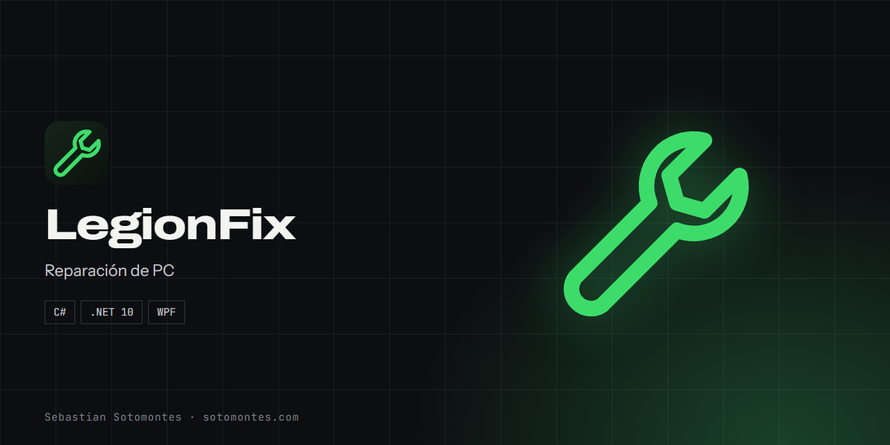
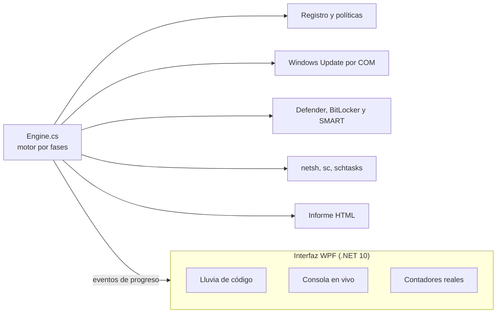

Diagnóstico y reparación de Windows con una interfaz cinematográfica, donde cada contador y hallazgo es un dato real del equipo.

<a href="https://sotomontes.com/#legionfix"><b>Ver en sotomontes.com</b></a> · <a href="#cómo-se-usa">Cómo se usa</a> · <a href="#cómo-funciona-por-dentro">Cómo funciona</a> · <a href="#novedades">Novedades</a>

| Ficha técnica | |
|---|---|
| **Autor** | Sebastian Sotomontes |
| **Tipo** | Reparación de PC |
| **Plataforma** | Windows 11 |
| **Versión** | 1.0.0 |
| **Estado** | Funcional |
| **Stack** | C# · .NET 10 · WPF |
| **Código** | Privado. Esta página es solo una presentación. |

---

## Qué es

LegionFix es una herramienta de diagnóstico y reparación de Windows con una interfaz cinematográfica de estilo terminal. Su regla principal es la honestidad: aunque se vea como una película, cada contador y cada hallazgo son datos reales del equipo. Nació para resolver problemas concretos, como que Office tardara en abrir archivos descargados.

## Novedades

- Versión en C# con modo diagnóstico que no modifica nada.

## Cómo se usa

1. Ejecuta primero el **modo diagnóstico**. Analiza el equipo sin modificar nada.
2. Observa la consola y los contadores mientras revisa cada fase.
3. Lee el informe y decide si quieres continuar.
4. Ejecuta el **modo reparación** con permisos de administrador. Antes de tocar nada crea un punto de restauración.
5. Al terminar, abre el informe en HTML con todo lo que se encontró y se corrigió.

## Funciones

- **Interfaz cinematográfica** con consola y contadores en vivo.
- **Datos reales**: cada cifra y hallazgo viene del equipo, nada es decorativo.
- **Modo diagnóstico** que analiza sin modificar nada.
- **Revisión** de actualizaciones, vulnerabilidades y mantenimiento.
- **Punto de restauración** antes de reparar e informe final en HTML.

## Detalles

- Fase de Office: encuentra archivos descargados que Windows marca como inseguros y hacen lenta su apertura.
- Fase de actualizaciones: revisa lo pendiente.
- Fase de vulnerabilidades: revisa la protección del equipo.
- Fase de mantenimiento y limpieza.
- En modo diagnóstico, los contadores de corregidos y liberados quedan en cero, como debe ser.

## Cómo funciona por dentro

### Arquitectura

### El motor por fases

| Fase | Qué hace |
|---|---|
| 0 | Crea un punto de restauración |
| 1 | Busca por qué Office tarda: archivos descargados con la marca de Internet y ubicaciones de confianza |
| 2 | Revisa las actualizaciones pendientes de Windows |
| 3 | Revisa vulnerabilidades y protección: Defender, BitLocker, arranque seguro y autorun |
| 4 | Revisa software no deseado y lo que lo reinstala |
| 5 | Mantenimiento y limpieza |
| 6 | Genera el informe final |

### Modo diagnóstico

Un solo indicador protege cada operación que modifica el sistema. En modo diagnóstico el motor recorre las mismas fases y hace las mismas lecturas, pero ninguna escritura se ejecuta, y por eso los contadores de corregidos y liberados quedan en cero.

### Sin dependencias

La aplicación no usa paquetes externos. Trabaja con el registro, las herramientas de Windows, la interfaz COM de Windows Update y llamadas nativas. Se ejecuta con permisos de administrador, que declara en su manifiesto.

### Por qué la interfaz no engaña

La parte visual es cinematográfica, pero cada número sale de una operación real. Es una decisión de diseño: una herramienta de diagnóstico que inventa datos no sirve para nada.

---

© 2026 Sebastian Sotomontes. Todos los derechos reservados.
